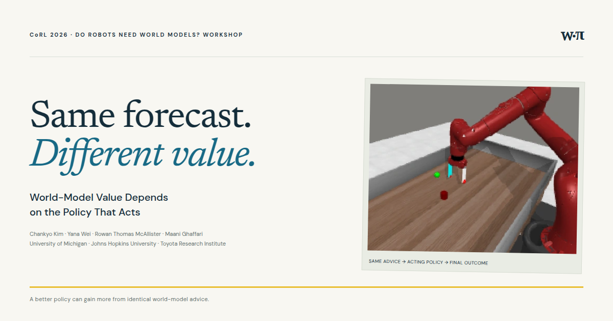
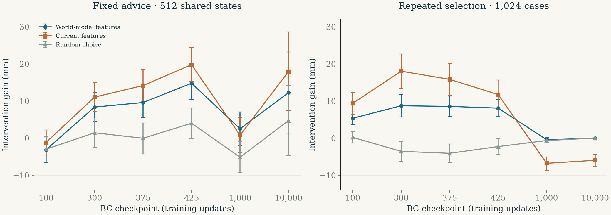
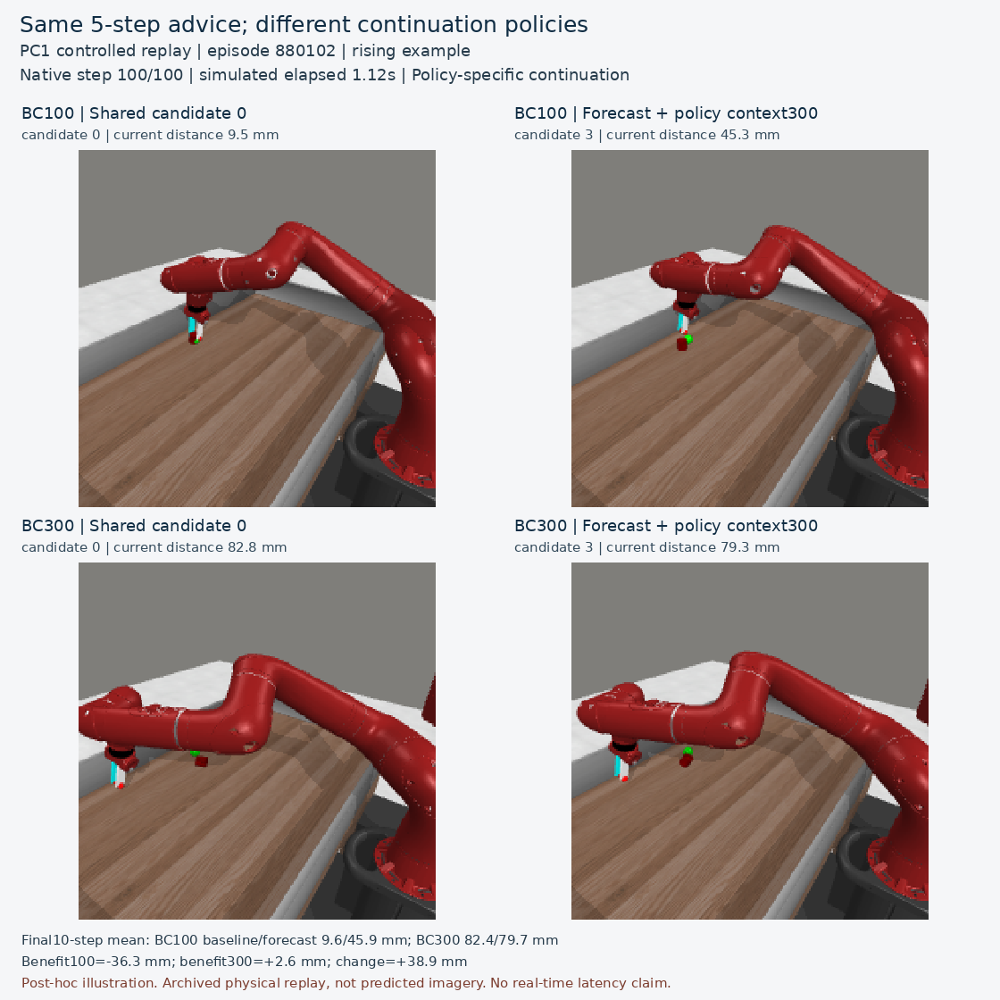
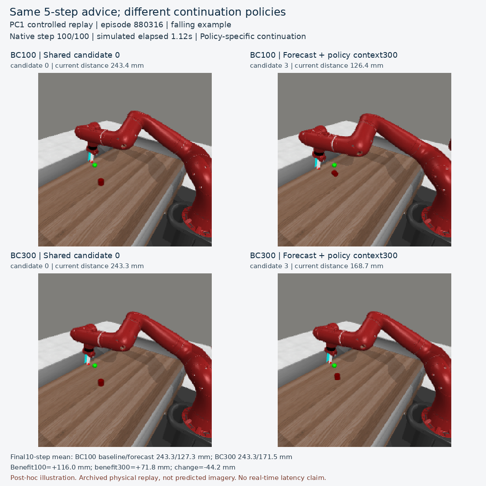

<p align="center">
  
</p>

<h1 align="center">World-Model Value Depends<br>on the Policy That Acts</h1>
<p align="center"><strong>CoRL 2026 · Do Robots Need World Models? Workshop</strong></p>
<p align="center">Chankyo Kim · Yana Wei · Rowan Thomas McAllister · Maani Ghaffari<br>University of Michigan · Johns Hopkins University · Toyota Research Institute</p>
<p align="center">
  <a href="https://chankyo123.github.io/world-model-policy-value"><strong>Project website ↗</strong></a> &nbsp;·&nbsp;
  <a href="https://openreview.net/forum?id=iEFLlkP566">Paper</a> &nbsp;·&nbsp;
  <a href="public/downloads/poster.pdf">Poster</a> &nbsp;·&nbsp;
  <a href="public/data/policy-value.csv">Result data</a> &nbsp;·&nbsp;
  <a href="#cite-this-work">Cite</a>
</p>

---

### The idea

**A better policy can gain more from identical world-model advice.** We argue that a world model should be evaluated together with the policy that acts on its predictions. A policy with better baseline performance can gain more from the same advice.

This repository contains the project website, frozen evaluation summaries, audited simulation videos, paper/poster PDFs and a script to reproduce the result plots.

### Hold the advice fixed. Change the policy that follows.

From each shared simulator state, compare two executions:

```text
Five common baseline commands  →  tested policy controls to the end  →  baseline distance
Five WM-selected commands      →  the same policy controls to the end →  distance with advice
```

Keep observations, forecasts, candidate plans and selected commands identical across the subsequent policies. Advice gain is baseline distance minus distance with advice, averaging the final ten steps of a 100-step episode.

### The central result

Across **512 matched states**, baseline performance improves and the value of identical advice increases:

| Acting policy | Baseline error ↓ | Error with advice ↓ | Advice gain ↑ |
| :------------ | ---------------: | ------------------: | ------------: |
| BC100         |        143.51 mm |           146.64 mm |      −3.13 mm |
| BC300         |        121.08 mm |           112.71 mm |      +8.37 mm |

**Baseline improvement: 22.43 mm. Change in advice gain: +11.50 mm**, paired 95% CI [6.80, 16.25]. The comparison was fixed before fresh evaluation. Positive family-adjusted lower bounds support the three primary quantities.

<p align="center"></p>

All six checkpoints are shown. They are saved policies from one BC training run, not a calibrated competence scale. Error bars above are descriptive paired 95% intervals; formal primary tests share 15 contrasts at family alpha .010.

### Benefit is not the same as predictive advantage

In repeated selection over 1,024 cases, BC300 gains **8.73 mm** from WM selection and **18.04 mm** from current-feature selection. Intervention benefit alone therefore does not establish the unique value of forecasting. The two evaluation protocols differ in targets, thresholds, schedules and baselines.

### Watch the robot replays

|                                             Greater gain through reduced harm                                             |                                             Smaller benefit from the same advice                                              |
| :-----------------------------------------------------------------------------------------------------------------------: | :---------------------------------------------------------------------------------------------------------------------------: |
| [](https://chankyo123.github.io/world-model-policy-value/#replays) | [](https://chankyo123.github.io/world-model-policy-value/#replays) |
|                                                   Gain: −36.3 → +2.6 mm                                                   |                                                    Gain: +116.0 → +71.8 mm                                                    |

[Watch both interactive replays on the project website ↗](https://chankyo123.github.io/world-model-policy-value/#replays)

Actual simulated trajectories, not predicted imagery. These are post-hoc examples from a separate exploratory study. The first example has a worse BC300 baseline; it illustrates reduced harm, not the better-baseline primary result. Both signs of gain change are retained.

### Two supporting diagnostics

| Question                                                       | Observation                                                                               | Interpretation                                                                                                                           |
| :------------------------------------------------------------- | :---------------------------------------------------------------------------------------- | :--------------------------------------------------------------------------------------------------------------------------------------- |
| Does the best short-term endpoint ensure better final control? | Actual 20-step endpoint selection at BC1000: +7.79 mm endpoint gain, −3.68 mm final gain. | Evaluate the outcome after the policy resumes control. Post-hoc; 256 separate cases.                                                     |
| Must a forecast match the action being evaluated?              | Matched forecasts: 17.08 mm; shuffled: 5.48 mm; current features: 15.13 mm.               | Correct correspondence helps this selector; superiority over current-feature scoring remains unresolved. Exploratory; 512 reused states. |

The endpoint study executes all 20 selected commands before BC1000 resumes and uses different BC inputs from the primary study. The correspondence study uses five-step forecasts and policy action descriptions; it is not the primary frozen selector.

### Run the project page

Requires Node.js 22.13 or newer.

```bash
npm ci
npm run dev
```

Open `http://localhost:3000/world-model-policy-value/`.

```bash
npm run build
npm run typecheck
npm run verify
```

The site uses Next.js/React and exports static HTML, CSS and JavaScript to `out/`. GitHub Pages serves the export without a backend. All scientific content, media and fonts are local assets. See [evaluation artifact documentation](research/README.md) to reproduce the plots from the CSV. This package does not include the full experiment pipeline or pretrained checkpoints.

### Publishing and updates

GitHub Actions builds, verifies, and deploys the site after a push to `main`. In repository **Settings → Pages**, set **Source** to **GitHub Actions** once. A failed validation prevents deployment.

- Edit the research narrative and interactions in `components/research/project-page.tsx`.
- Edit the layout and responsive styling in `app/project.css`.
- Replace PDFs in `public/downloads/`, videos/images in `public/media/`, and update `public/data/provenance.json` when an audited artifact changes.
- The bundled poster is **V10**; the manuscript is **V17**.
- Shared hosting URLs and the repository subpath are in `lib/site.ts`. Update this file if the repository name changes.

### Evidence in context

One simulated pushing task and one BC training run; privileged observations; physics paused during inference. Candidate-evaluation computation at BC300 was 1.001 s/episode for WM and 0.057 s for direct scoring. These times do not measure physical waiting loss.

### Cite this work

```bibtex
@inproceedings{kim2026worldmodelvalue,
  title = {World-Model Value Depends on the Policy That Acts},
  author = {Kim, Chankyo and Wei, Yana and McAllister, Rowan Thomas and Ghaffari, Maani},
  booktitle = {CoRL Workshop on Do Robots Need World Models?},
  year = {2026},
  url = {https://openreview.net/forum?id=iEFLlkP566}
}
```

### Acknowledgments

Experiments use Meta-World and a frozen JEPA-WM predictor. See the manuscript for full references. Website typography uses DM Sans and Newsreader under their bundled Open Font Licenses. Institutional marks identify affiliations. Design references: [Diffusion Policy](https://diffusion-policy.cs.columbia.edu/) and [Physical Intelligence](https://www.pi.website/blog/pi0); their content and imagery are not reused.
